<div align="center">

# FitLearn

### 같은 교안, 나에게 맞는 설명으로.

1분 성향 진단으로 학습 스타일을 파악하고, 교수님이 올린 교안을<br>
**시각형 · 청각형 · 읽기형 · 실습형 · 요약형 · 상세형** 중 내게 맞는 방식으로 **실시간 재구성**하는 AI 맞춤 학습 엔진

[](https://fit-learn-phi.vercel.app)
[](docs/index.html)


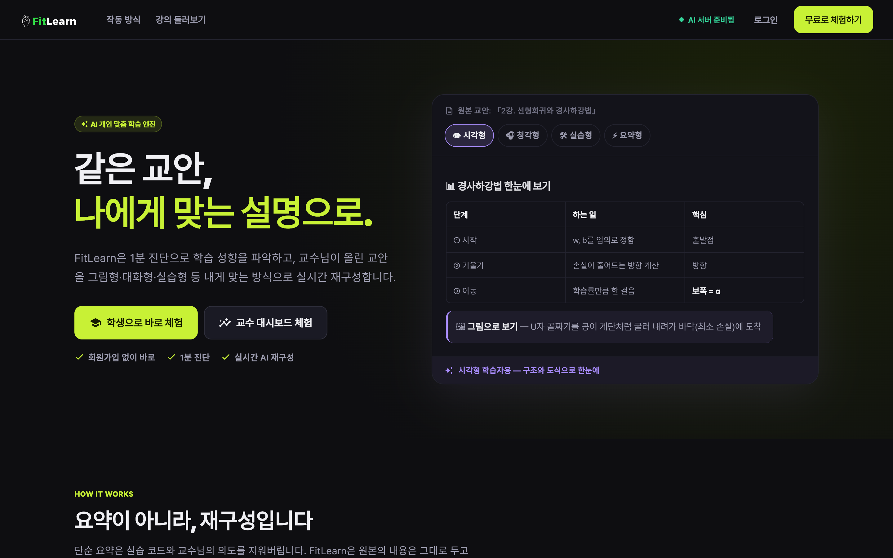

</div>

---

## 목차

1. [바로 체험하기](#-바로-체험하기)
2. [왜 FitLearn인가](#-왜-fitlearn인가)
3. [서비스 화면](#-서비스-화면)
4. [서비스 소개 페이지](#-서비스-소개-페이지)
5. [작동 방식](#-작동-방식)
6. [아키텍처](#-아키텍처)
7. [기술 스택](#-기술-스택)
8. [로컬 실행](#-로컬-실행)
9. [배포](#-배포)
10. [API](#-api)
11. [디렉터리 구조](#-디렉터리-구조)
12. [팀](#-팀)

---

## 🚀 바로 체험하기

> **https://fit-learn-phi.vercel.app** — 회원가입 없이 버튼 하나로 체험 계정이 만들어집니다.

| 체험 | 흐름 | 소요 |
|---|---|---|
| 🎓 **학생** | 「학생으로 바로 체험」 → 6문항 성향 진단 → 데모 강의 맞춤 교안 **실시간 스트리밍** → 6가지 설명 방식 전환 · 원본과 비교 · AI 튜터 질문 | 약 2분 |
| 📈 **교수** | 「교수 대시보드 체험」 → 개인 데모 강의실(가상 수강생 8명) → 학습 성향 대시보드 · AI 수업 인사이트 → 샘플 교안 업로드로 AI 핵심 포인트 추출·검토 | 약 3분 |

같은 브라우저로 다시 접속하면 이전 체험 계정을 이어서 사용합니다.

---

## 💡 왜 FitLearn인가

같은 강의 자료를 보더라도 학생마다 이해하는 방식은 다릅니다. 어떤 학생은 그림과 구조도를 먼저 볼 때, 어떤 학생은 말로 풀어 줄 때, 어떤 학생은 직접 해볼 때 가장 잘 배웁니다. 하지만 온라인 강의는 **하나의 교안, 하나의 설명 방식**만 제공하고, 단순 요약 AI는 실습 코드와 교수님의 의도마저 지워버립니다.

FitLearn은 **요약이 아니라 재구성**합니다.

| | 기존 방식 | FitLearn |
|---|---|---|
| 설명 방식 | 모든 학생에게 동일 | 학습 성향별 6가지 구조로 재구성 |
| 교수 의도 | AI 요약 과정에서 손실 | 교수 확정 핵심 포인트를 100% 반영 |
| 실습 코드 | 압축·누락 | 원본 그대로 보존 |
| 신뢰성 | 무엇이 바뀌었는지 알 수 없음 | 원본과 나란히 비교 |
| 대기 시간 | 생성 완료까지 수십 초 대기 | SSE 스트리밍으로 첫 문장 약 2초 |

---

## 📸 서비스 화면

### 학생

<table>
<tr>
<td width="50%">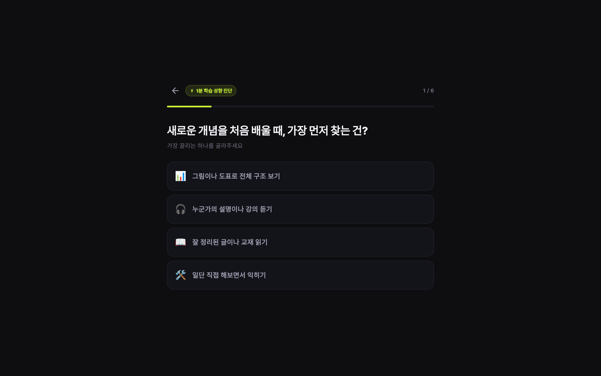<br><b>① 1분 성향 진단</b><br>6문항, AI 호출 없이 즉시 결과</td>
<td width="50%">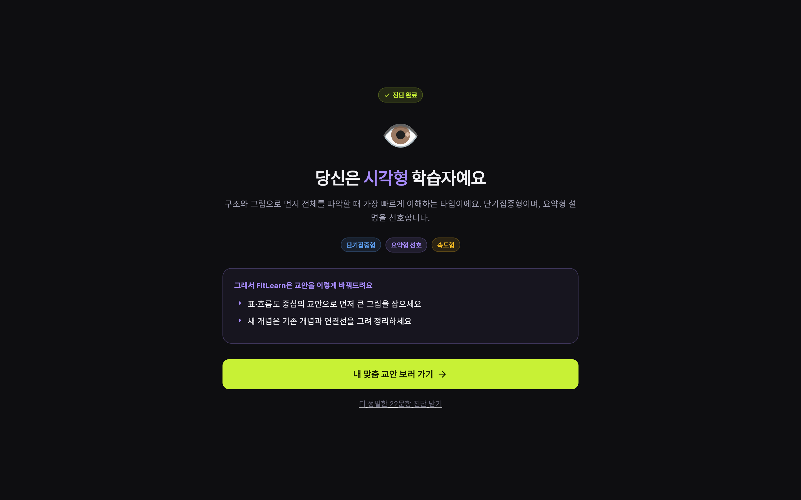<br><b>② 진단 결과</b><br>내 유형과 교안이 바뀌는 방식을 바로 안내</td>
</tr>
<tr>
<td>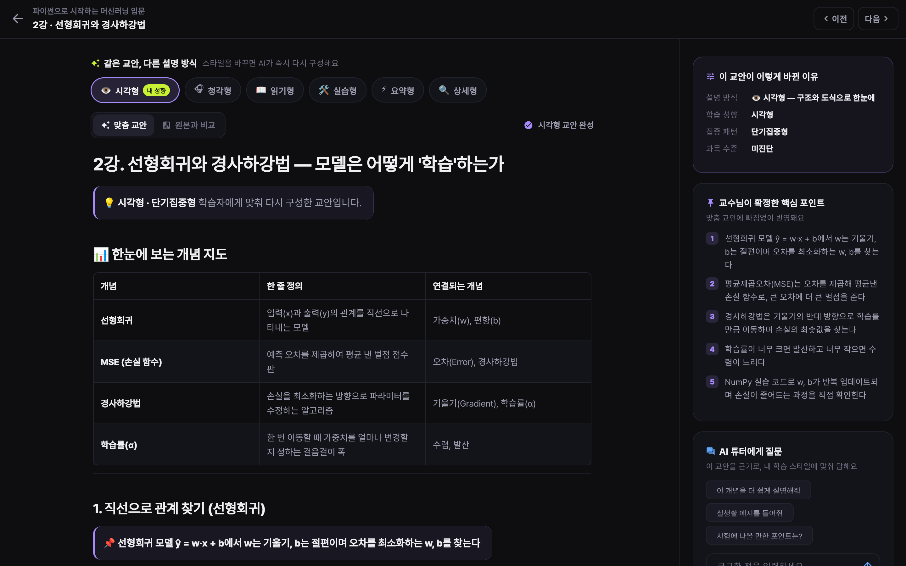<br><b>③ 시각형 맞춤 교안</b><br>개념 지도 표 · 교수 핵심 포인트 · 바뀐 이유</td>
<td>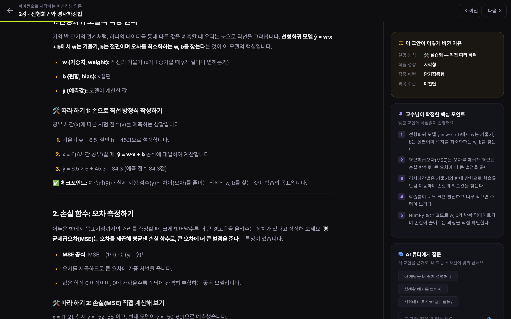<br><b>④ 실습형으로 전환</b><br>같은 강의가 미션·따라 하기·체크포인트 구조로</td>
</tr>
<tr>
<td>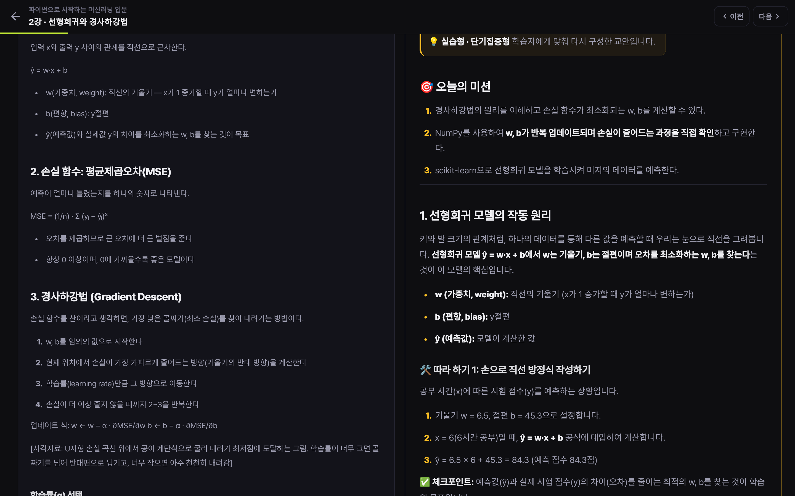<br><b>⑤ 원본과 나란히 비교</b><br>무엇이 어떻게 바뀌었는지 투명하게</td>
<td>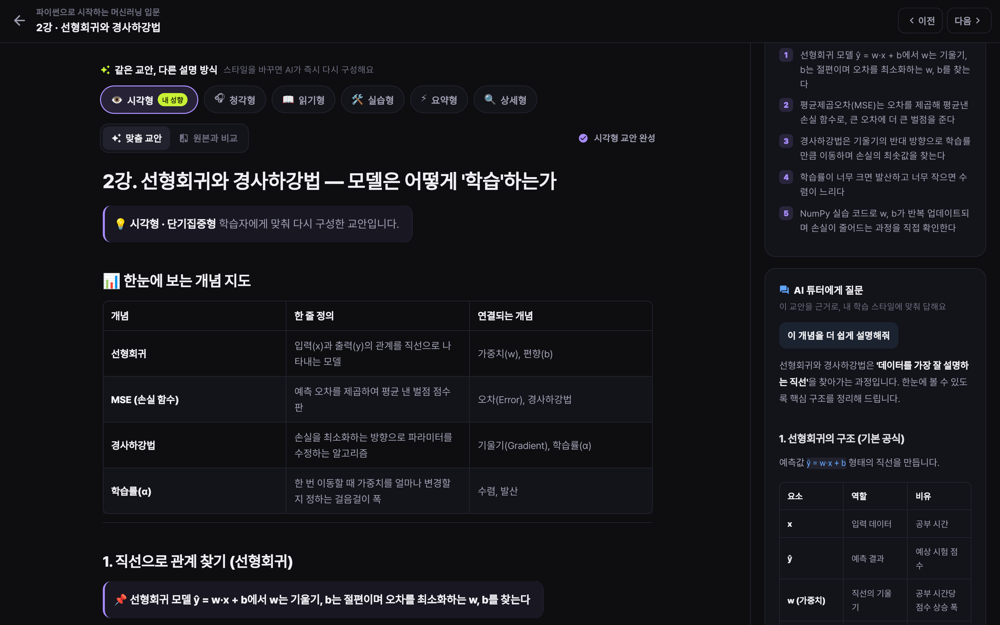<br><b>⑥ 교안 근거 AI 튜터</b><br>내 스타일에 맞춘 답변을 실시간 스트리밍</td>
</tr>
<tr>
<td colspan="2">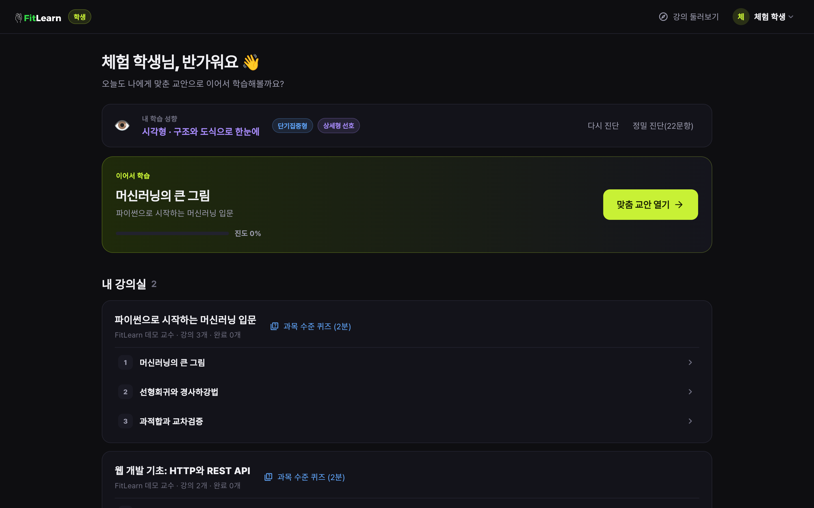<br><b>⑦ 학생 홈</b> — 내 학습 성향, 이어서 학습, 강의실별 진도와 과목 수준 퀴즈</td>
</tr>
</table>

### 교수

<table>
<tr>
<td width="50%">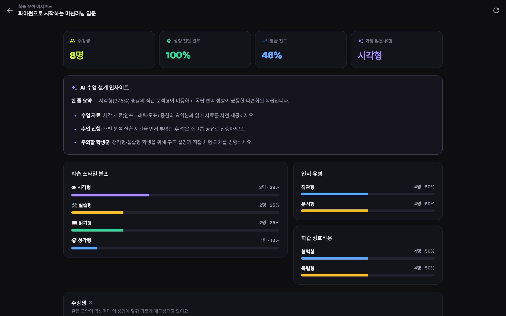<br><b>학습 분석 대시보드</b><br>성향 분포 + AI 수업 설계 인사이트</td>
<td width="50%">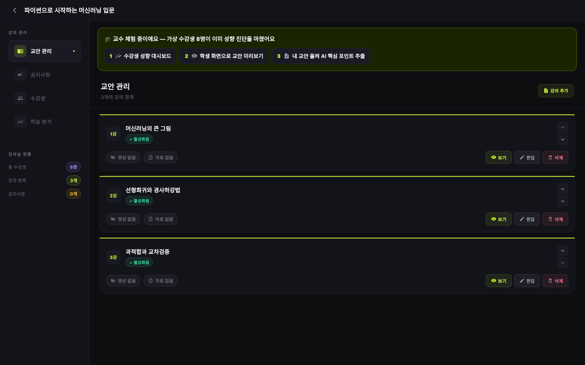<br><b>강의실 · 교안 관리</b><br>체험 가이드, 교안 업로드 → AI 핵심 포인트 → 검토·확정</td>
</tr>
</table>

### 모바일

<p align="center">
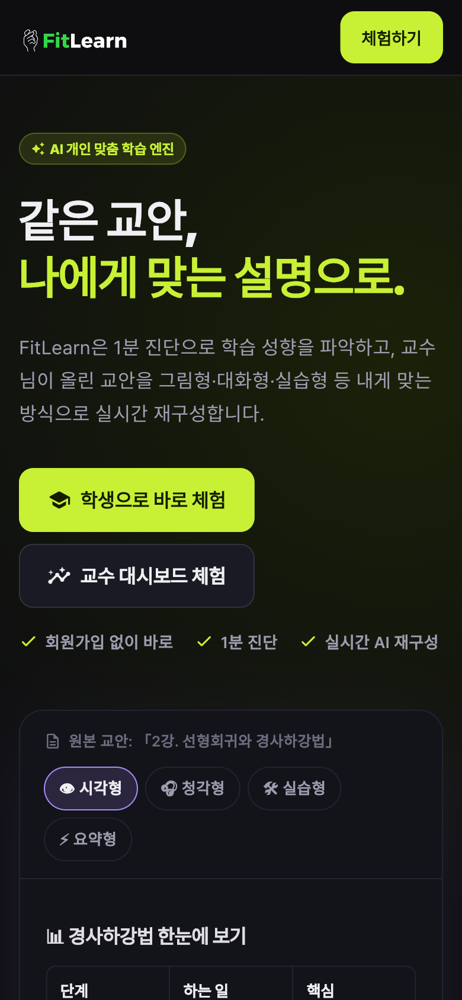
&nbsp;&nbsp;
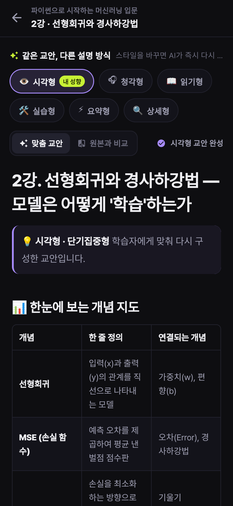
</p>

---

## 🧭 서비스 소개 페이지

[`docs/index.html`](docs/index.html)은 이 README의 캡처를 그대로 사용하는 **단일 파일 서비스 소개(랜딩) 페이지 템플릿**입니다.

- 앱과 같은 디자인 토큰(다크 + 라임/라벤더)으로 작성되어 브랜드가 일관됩니다.
- 히어로 → 문제 정의 → 작동 방식 → 학생/교수 기능 쇼케이스 → 모바일 → 기술 → CTA 구성
- `docs/screenshots/`의 이미지만 교체하면 레이아웃은 그대로 유지됩니다.
- **GitHub Pages로 바로 공개**: Settings → Pages → Branch `main` / Folder `/docs`

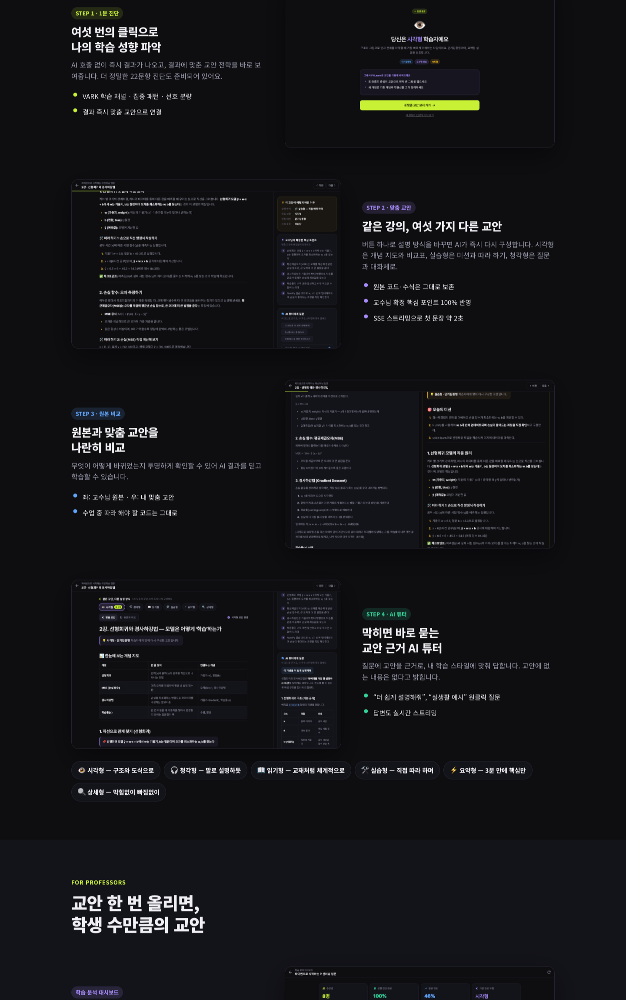

<details>
<summary><b>소개 페이지 전체 보기 (클릭)</b></summary>
<br>
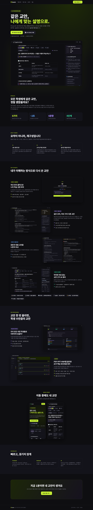
</details>

---

## ⚙️ 작동 방식

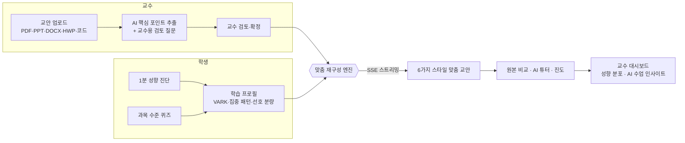

### 맞춤 재구성 엔진의 원칙

1. **요약이 아니라 재구성** — 원본의 개념·사실·예시는 남기고 전달 구조와 어조만 바꿉니다.
2. **환각 금지** — 원본에 없는 사실·수치·코드를 만들지 않습니다.
3. **원본 보존** — 코드·수식·명령어·실행 결과는 그대로 코드블록에 둡니다.
4. **교수 의도 우선** — 교수가 확정한 핵심 포인트를 모두, 눈에 띄게 포함합니다.
5. **스타일별 설계도** — 시각형은 개념 지도·비교표, 청각형은 질문→대화체, 실습형은 미션→따라 하기→응용 과제처럼 스타일마다 문서 구조 자체가 다릅니다.
6. **세부 성향 반영** — 집중 패턴(단기/장기), 난이도 대응(직진/우회/지원요청), 과목 수준(입문/중급/고급)을 지침으로 덧입힙니다.

---

## 🏗 아키텍처

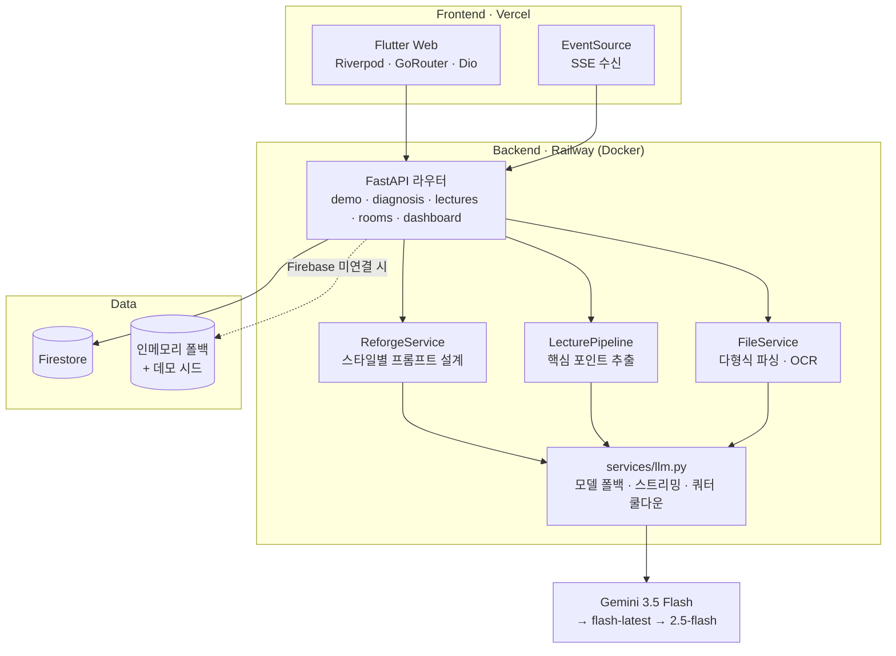

| 설계 포인트 | 내용 |
|---|---|
| **원클릭 데모** | `POST /demo/bootstrap`이 방문자별 `demo-student-*` / `demo-professor-*` 계정을 만들고, 학생은 데모 강의에 자동 수강, 교수는 가상 수강생 8명이 있는 개인 강의실 사본을 받습니다. |
| **장애 내성** | Firebase 자격증명이 없거나 실패하면 인메모리 Firestore로 자동 전환되고, 서버 시작 시 데모 강의를 시드합니다. 재시작으로 데이터가 사라져도 프론트가 체험 계정을 자동 복구합니다. |
| **체감 속도** | 맞춤 교안·AI 튜터 모두 SSE 스트리밍. 모델별 사고(thinking) 단계를 최소화해 첫 토큰 약 2초. 스타일별 결과는 캐시되어 재방문 시 즉시 표시됩니다. |
| **모델 안정성** | 단일 진입점 `services/llm.py`에서 모델 폴백 체인과 쿼터 초과 쿨다운을 처리하고, 실패 시 원본 근거 기반 교안으로 대체합니다. |
| **출력 품질** | 마크다운 후처리(LaTeX → 유니코드 수식, 코드블록 보존), 한글 굵게 렌더링 보정, 표·코드 복사·체크리스트를 지원하는 공용 렌더러. |

---

## 🧰 기술 스택

| 영역 | 기술 |
|---|---|
| Frontend | Flutter Web, Dart 3, Riverpod, GoRouter, Dio, flutter_markdown(GFM), EventSource, Pretendard |
| Backend | Python 3.11, FastAPI, Uvicorn, Pydantic, httpx(SSE), slowapi |
| AI | Gemini API (`gemini-3.5-flash` 기본 + 폴백 체인), 교육 이론(VARK·CLT·Kolb·Felder-Silverman) 기반 프롬프트 |
| 파일 파싱 | PyMuPDF, pdfplumber, python-pptx, python-docx, Gemini Vision OCR |
| Data | Firebase Auth / Firestore / Storage, 인메모리 폴백, Redis(선택) |
| Infra | Vercel(Frontend), Railway Docker(Backend), GitHub Actions(스모크 테스트) |

---

## 💻 로컬 실행

### 백엔드

```bash
cd backend
python3.11 -m venv .venv && source .venv/bin/activate
pip install -r requirements.txt
```

`backend/.env` (서버 시작 시 자동 로드)

```bash
GEMINI_API_KEY=your_gemini_api_key
# 선택
GEMINI_MODEL=gemini-3.5-flash
GEMINI_MODEL_FALLBACKS=gemini-flash-latest,gemini-2.5-flash
FIREBASE_CREDENTIALS='{"type":"service_account", ...}'   # 없으면 인메모리 저장소 + 데모 강의로 실행
```

```bash
uvicorn main:app --port 10000 --reload
curl localhost:10000/api/v1/health
```

### 프론트엔드

```bash
cd frontend
flutter pub get
flutter run -d chrome --dart-define=API_BASE_URL=http://localhost:10000
```

### 테스트

```bash
cd backend && pytest -q        # 외부 API 없이 인메모리로 도는 스모크 테스트
cd frontend && flutter analyze
```

---

## ☁️ 배포

| 대상 | 방식 |
|---|---|
| Frontend | `main` push → Vercel 자동 빌드 (`frontend/vercel.json`) |
| Backend | `cd backend && railway up` → Railway가 `Dockerfile`로 빌드, `$PORT` 자동 주입 |

프론트의 기본 API 주소는 `https://fitlearn-backend-production.up.railway.app`이며, `--dart-define=API_BASE_URL=...`로 바꿀 수 있습니다.

---

## 🔌 API

| Method | Path | 설명 |
|---|---|---|
| `POST` | `/api/v1/demo/bootstrap` | 원클릭 체험 계정 생성 (학생: 데모 강의 자동 수강 / 교수: 개인 데모 강의실) |
| `POST` | `/api/v1/diagnosis/quick` | 6문항 빠른 성향 진단 (즉시 결과) |
| `POST` | `/api/v1/diagnosis` | 22문항 정밀 성향 진단 (RAG + AI 분석) |
| `GET` | `/api/v1/lectures/{room}/{lecture}/reforged/stream` | 맞춤 교안 **SSE 스트리밍** (`style`로 스타일 전환, 캐시) |
| `GET` | `/api/v1/lectures/{room}/{lecture}/ask/stream` | 교안 근거 AI 튜터 **SSE 스트리밍** |
| `POST` | `/api/v1/lectures/upload` | 교안 업로드 → 파싱 → AI 핵심 포인트 추출 |
| `POST` | `/api/v1/lectures/{room}/{lecture}/confirm` | 교수 핵심 포인트 확정 |
| `GET` | `/api/v1/courses` | 공개 강의 목록 |
| `GET` | `/api/v1/rooms/student/{user}/hub` | 학생 홈 통합 데이터 |
| `GET` | `/api/v1/rooms/{room}/quiz` · `POST .../quiz/submit` | 과목 수준 퀴즈 |
| `GET` | `/api/v1/dashboard/{room}` | 교수 대시보드 (성향 분포 + AI 인사이트) |
| `GET` | `/api/v1/health` | 헬스체크 (저장소 모드 포함) |

---

## 📁 디렉터리 구조

```text
FitLearn/
├── backend/
│   ├── main.py                      # FastAPI 진입점, .env 자동 로드, 데모 시드
│   ├── Dockerfile                   # Railway 배포 ($PORT)
│   ├── api/v1/routers/              # demo · diagnosis · lectures · rooms · dashboard · auth
│   ├── services/
│   │   ├── llm.py                   # Gemini 호출 단일 진입점 (폴백·스트리밍)
│   │   ├── reforge_service.py       # 스타일별 맞춤 재구성 프롬프트
│   │   ├── lecture_pipeline.py      # 핵심 포인트 추출
│   │   ├── demo_seed.py             # 데모 강의·체험 계정
│   │   ├── memory_firestore.py      # Firestore 인메모리 폴백
│   │   └── firebase_service.py
│   └── tests/                       # 오프라인 스모크 테스트
├── frontend/
│   ├── lib/
│   │   ├── core/theme/tokens.dart   # 디자인 토큰
│   │   ├── features/
│   │   │   ├── landing/             # 랜딩 · 강의 상세
│   │   │   ├── student/             # 1분 진단 · 홈 · 교안 리더 · 퀴즈
│   │   │   └── professor/           # 강의실 · 업로드 · 핵심 포인트 검토 · 대시보드
│   │   └── shared/                  # SSE 클라이언트 · 마크다운 렌더러 · 공용 UI
│   └── assets/fonts/                # Pretendard Std (OFL)
└── docs/
    ├── index.html                   # 서비스 소개 페이지 템플릿
    ├── screenshots/                 # README·소개 페이지 캡처
    └── firebase_schema.md
```

---

## 👥 팀

**표리부동** — KIT 바이브코딩 공모전 출품작

| 이름 | 역할 |
|---|---|
| 이승희 | 기획, 서비스 구조, AI/서버 엔진, 프론트엔드 연동 |
| 표제원 | 기획, 프론트엔드 UI/UX, 학생 성향 진단 화면 및 서비스 플로우 |

---

<div align="center">

© 2026 이승희, 표제원. All Rights Reserved. — [LICENSE](LICENSE)

Pretendard 폰트는 [SIL Open Font License 1.1](frontend/assets/fonts/LICENSE.txt)을 따릅니다.

</div>
