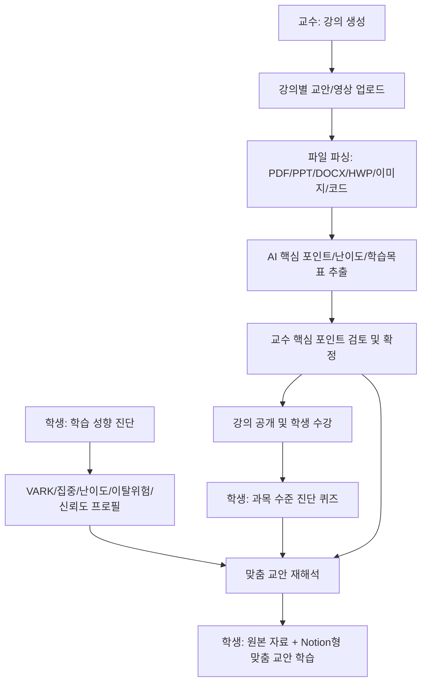
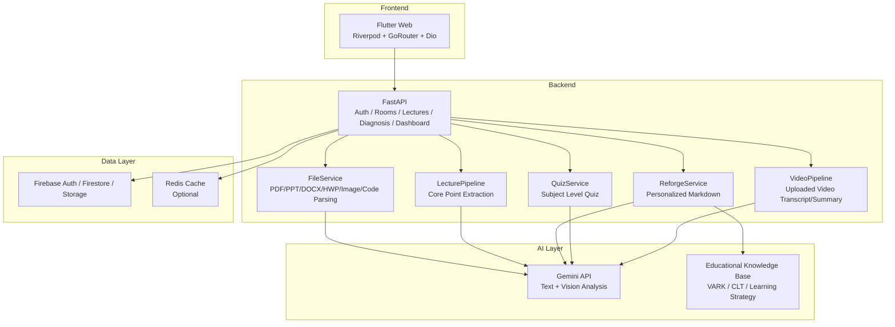

# FitLearn

## AI 기반 개인 맞춤형 교안 재해석 학습 플랫폼

FitLearn은 교수자가 업로드한 강의 자료를 AI가 분석하고, 학생의 학습 성향과 과목 수준에 맞게 교안을 재구성해 제공하는 교육 서비스입니다.  
본 프로젝트는 **KIT 바이브코딩 공모전** 참가작으로, 교수자는 강의 개설과 교안 관리에 집중하고 학생은 자신에게 맞는 형태로 강의 자료를 학습할 수 있도록 설계되었습니다.

강의 자료는 PDF, PPT/PPTX, DOCX, HWP/HWPX, Markdown, 텍스트, 코드 파일, 이미지 등 다양한 형식을 지원합니다. 업로드된 자료는 텍스트 추출, 시각자료/OCR 보조 분석, 핵심 포인트 추출, 교수 검토, 학생 맞춤형 재해석 과정을 거쳐 Notion 문서처럼 읽기 쉬운 마크다운 기반 학습 자료로 변환됩니다.

---

## 1. 개발 동기

같은 강의 자료를 보더라도 학생마다 이해 방식은 다릅니다. 어떤 학생은 그림과 구조도를 먼저 볼 때 이해가 빠르고, 어떤 학생은 텍스트 정리나 실습 예제가 있어야 학습 흐름을 따라갈 수 있습니다. 또한 교수자가 업로드한 교안에는 수업 중 반드시 따라 해야 하는 코드, 실습 순서, 도식, 핵심 개념이 함께 섞여 있어 단순 요약만으로는 실제 수업 활용성이 떨어질 수 있습니다.

FitLearn은 이러한 문제를 해결하기 위해 **교수의 핵심 포인트 판단**, **학생 학습성향 진단**, **과목 수준 진단**, **교안 재해석 AI 파이프라인**을 하나의 흐름으로 연결했습니다.

---

## 2. 해결하고자 한 문제

- 교수자가 올린 교안의 핵심 내용을 학생 수준과 성향에 맞춰 다시 설명하기 어렵다.
- 교안 요약만으로는 실습 코드, 수업 순서, 시각자료의 의미가 사라질 수 있다.
- 학생의 학습 성향과 과목별 이해 수준이 교안 제공 방식에 충분히 반영되지 않는다.
- 온라인 강의와 업로드 자료가 분리되어 있어 영상, 원본 자료, 재해석 교안을 함께 보기 어렵다.
- 교수자는 강의 자료 업로드 후 “무엇을 반드시 강조해야 하는지”를 다시 점검할 수 있는 도구가 부족하다.

---

## 3. 핵심 기능

| 구분 | 기능 | 설명 |
|---|---|---|
| 교수 | 강의 생성 및 관리 | 강의명, 소개, 커리큘럼, 가격, 강의별 자료/영상 업로드 |
| 교수 | 교안 업로드 | PDF, PPT/PPTX, DOCX, HWP/HWPX, 이미지, 코드 파일 등 다형식 자료 업로드 |
| 교수 | 핵심 포인트 검토 | AI가 추출한 핵심 포인트를 교수가 선택, 수정, 우선순위 조정 |
| 학생 | 강의 탐색 및 수강 | 공개 강의 목록 조회, 수강 등록, 내 강의함 연동 |
| 학생 | 학습 성향 진단 | VARK, 집중 패턴, 난이도 대응, 이탈 위험, 신뢰도 기반 프로필 생성 |
| 학생 | 과목 수준 진단 | 강의 입장 전 퀴즈를 통해 beginner/intermediate/advanced 수준 판단 |
| 학생 | 맞춤 교안 보기 | 교안 + 교수 핵심 포인트 + 학생 성향 + 과목 수준을 반영한 마크다운 교안 |
| 학생 | 원본/재해석 병행 | 원본 자료와 AI 재해석 교안을 함께 확인 |
| AI | 강의 자료 분석 | 텍스트 추출, 시각자료 OCR, 핵심 포인트, 난이도, 학습 목표 생성 |
| AI | 영상 보조 | 업로드 영상 전사/요약 및 구간 질문 기반 학습 보조 |

---

## 4. 학습성향 및 개인화 기준

FitLearn의 맞춤형 교안은 단순한 요약이 아니라 아래 기준을 조합해 재해석하는 것을 목표로 합니다.

| 기준 | 예시 |
|---|---|
| VARK 유형 | 시각 / 청각 / 읽기 / 실습 |
| 집중 패턴 | 단기집중형 / 장기몰입형 / 분산형 |
| 난이도 대응 | 직진형 / 우회형 / 지원요청형 |
| 이탈 위험 인자 | 난이도 / 동기 / 고립 / 루틴 |
| 신뢰도 점수 | S8↔S16, S9↔S17, S11↔S18 교차 검증 |
| 과목 수준 | beginner / intermediate / advanced |

교안 재해석 시에는 교수자가 확정한 핵심 포인트를 기준으로 삼고, 실습 코드와 수업 중 따라 해야 하는 절차는 가능한 한 보존하도록 설계했습니다.

---

## 5. 전체 서비스 흐름



---

## 6. 아키텍처



---

## 7. 기술 스택

| 영역 | 기술 |
|---|---|
| Frontend | Flutter, Dart, Riverpod, GoRouter, Dio, Flutter Markdown |
| Auth / Data | Firebase Auth, Cloud Firestore, Firebase Storage |
| Backend | Python, FastAPI, Uvicorn, Pydantic |
| AI | Gemini API, google-genai, google-generativeai |
| File Parsing | PyPDF2, pdfplumber, PyMuPDF, python-pptx, python-docx |
| RAG / Search | LangChain, FAISS, 자체 교육 이론 지식 베이스 |
| Cache / Monitoring | Redis, Sentry |
| Deploy | Vercel(Frontend), Render(Backend) |

---

## 8. 디렉토리 구조

```text
FitLearn/
├── backend/
│   ├── main.py                         # FastAPI 앱 진입점
│   ├── requirements.txt                # Python 의존성
│   ├── api/v1/routers/
│   │   ├── auth.py                     # 사용자 등록/프로필/활성 상태
│   │   ├── rooms.py                    # 강의방, 강의 목록, 수강, 퀴즈, 공지
│   │   ├── lectures.py                 # 교안 업로드, 핵심 포인트 확정, 재해석, 영상 보조
│   │   ├── diagnosis.py                # 학습 성향 진단
│   │   ├── dashboard.py                # 대시보드 데이터
│   │   └── reforge.py                  # 교안 재가공 API
│   ├── models/                         # Pydantic 요청/응답 모델
│   └── services/
│       ├── file_service.py             # 다형식 파일 텍스트/OCR 추출
│       ├── lecture_pipeline.py         # 핵심 포인트 추출 파이프라인
│       ├── reforge_service.py          # 학생 맞춤 교안 생성
│       ├── quiz_service.py             # 과목 수준 퀴즈 생성/채점
│       ├── video_pipeline.py           # 업로드 영상 전사/요약
│       ├── firebase_service.py         # Firestore/Storage 연동
│       └── rag_pipeline/               # 교육 이론 기반 RAG 보조 모듈
│
├── frontend/
│   ├── lib/
│   │   ├── core/                       # 라우터, 테마, API 상수
│   │   ├── features/
│   │   │   ├── landing/                # 강의 탐색/상세
│   │   │   ├── auth/                   # 로그인/회원가입
│   │   │   ├── professor/              # 교수 홈, 강의 관리, 핵심 포인트 검토
│   │   │   └── student/                # 학생 홈, 진단, 강의 보기
│   │   └── shared/                     # 공용 서비스, Provider, 위젯
│   ├── web/                            # Flutter Web 정적 파일, favicon, manifest
│   └── pubspec.yaml
│
├── docs/
│   └── firebase_schema.md              # Firestore 스키마 정리
└── render.yaml                         # Render 백엔드 배포 설정
```

---

## 9. 실행 방법

### 9.1 사전 요구사항

- Flutter SDK 3.4 이상
- Dart SDK 3.4 이상
- Python 3.11 이상
- Firebase 프로젝트 및 서비스 계정
- Gemini API Key
- 선택 사항: Redis, Sentry DSN

### 9.2 백엔드 실행

```bash
cd backend
python -m venv .venv
source .venv/bin/activate
pip install -r requirements.txt
```

`backend/.env.development` 또는 실행 환경에 아래 값을 설정합니다.

```bash
GEMINI_API_KEY=your_gemini_api_key
FIREBASE_PROJECT_ID=your_firebase_project_id
FIREBASE_CREDENTIALS='{"type":"service_account", "...":"..."}'
FIREBASE_STORAGE_BUCKET=your_bucket_name
REDIS_URL=redis://localhost:6379
SENTRY_DSN=
PUBLIC_BACKEND_URL=http://localhost:10000
```

로컬 서버 실행:

```bash
uvicorn main:app --host 0.0.0.0 --port 10000 --reload
```

상태 확인:

```bash
curl http://localhost:10000/
curl http://localhost:10000/api/v1/health
```

### 9.3 프론트엔드 실행

```bash
cd frontend
flutter pub get
flutter run -d chrome --dart-define=API_BASE_URL=http://localhost:10000
```

배포 백엔드를 그대로 사용할 경우:

```bash
cd frontend
flutter pub get
flutter run -d chrome
```

기본 API 주소는 코드상 `https://fitlearn-backend.onrender.com`로 설정되어 있습니다.

### 9.4 테스트 및 정적 분석

백엔드 테스트:

```bash
cd backend
pytest -q
```

프론트엔드 분석:

```bash
cd frontend
flutter analyze
```

### 9.5 배포

백엔드는 `render.yaml` 기준으로 Render에 배포합니다.

```yaml
rootDir: backend
buildCommand: pip install -r requirements.txt
startCommand: uvicorn main:app --host 0.0.0.0 --port $PORT
```

프론트엔드는 Flutter Web 빌드 후 Vercel 등 정적 호스팅에 배포할 수 있습니다.

```bash
cd frontend
flutter build web --dart-define=API_BASE_URL=https://fitlearn-backend.onrender.com
```

---

## 10. 주요 API 요약

| API | 설명 |
|---|---|
| `POST /api/v1/auth/register` | 사용자 등록 및 프로필 저장 |
| `GET /api/v1/courses` | 공개 강의 목록 조회 |
| `POST /api/v1/courses/{course_id}/enroll` | 학생 수강 등록 |
| `POST /api/v1/rooms` | 교수 강의 생성 |
| `GET /api/v1/rooms/professor/{professor_uid}` | 교수 강의 목록 조회 |
| `GET /api/v1/rooms/student/{user_id}/hub` | 학생 홈 통합 데이터 조회 |
| `POST /api/v1/lectures/upload` | 교안/영상 업로드 및 교안 분석 |
| `POST /api/v1/lectures/{room_id}/{lecture_id}/confirm` | 교수 핵심 포인트 확정 |
| `GET /api/v1/lectures/{room_id}/{lecture_id}/reforged` | 학생 맞춤 교안 생성/조회 |
| `POST /api/v1/diagnosis` | 학습 성향 진단 |
| `GET /api/v1/rooms/{room_id}/quiz` | 과목 수준 진단 퀴즈 조회 |
| `POST /api/v1/rooms/{room_id}/quiz/submit` | 과목 수준 진단 퀴즈 제출 |

---

## 11. 데이터 구조 요약

Firestore는 다음 구조를 중심으로 사용합니다. 자세한 내용은 `docs/firebase_schema.md`를 참고합니다.

```text
users/{userId}
diagnosis/{userId}
rooms/{roomId}
rooms/{roomId}/lectures/{lectureId}
rooms/{roomId}/lectures/{lectureId}/reforged/{userId}
rooms/{roomId}/notices/{noticeId}
room_applications/{roomId}_{userId}
subject_levels/{userId}_{roomId}
```

---

## 12. 기대효과와 사회적 가치

FitLearn은 학생에게는 “나에게 맞는 교안”을 제공하고, 교수에게는 “강의 자료의 핵심을 다시 점검하는 도구”를 제공합니다. 이를 통해 학습 격차를 줄이고, 자료를 잘 읽는 학생과 그렇지 못한 학생 사이의 접근성 차이를 완화할 수 있습니다. 특히 실습 코드와 시각자료를 보존하는 방향으로 설계되어 단순 요약형 AI보다 실제 수업 현장에서 활용 가능성이 높습니다.

장기적으로는 학습자 개개인의 인지 특성과 과목별 수준을 반영한 교육 콘텐츠 제공 방식으로 확장할 수 있으며, 이는 개인 맞춤형 교육과 학습 접근성 향상에 기여할 수 있습니다.

---

## 13. 개선 예정 사항

- 기존 업로드 교안을 서버에서 다시 읽어 재분석하는 재분석 API 고도화
- 영상 전사 품질 개선 및 긴 영상 비동기 처리 큐 도입
- OCR 기반 시각자료 보존 품질 향상
- Redis 캐시 운영 환경 안정화 및 캐시 무효화 정책 정교화
- 과목 수준 진단 퀴즈 품질 평가 및 문항 난이도 자동 보정
- 교수/학생 대시보드 지표 고도화

---

## 14. 팀

| 이름 | 역할 |
|---|---|
| 이승희 | 기획, 서비스 구조, AI/서버 엔진, 프론트엔드 연동 |
| 표제원 | 프론트엔드 UI/UX, 학생 성향 진단 화면 및 서비스 플로우 |

---

## 15. 프로젝트 정보

- 프로젝트명: FitLearn
- 참가 공모전: KIT 바이브코딩 공모전
- 서비스 유형: AI 기반 개인 맞춤형 학습 플랫폼
- 핵심 키워드: 학습성향 진단, 과목 수준 진단, 교안 재해석, 교수 핵심 포인트 검토, AI 교안 파이프라인
